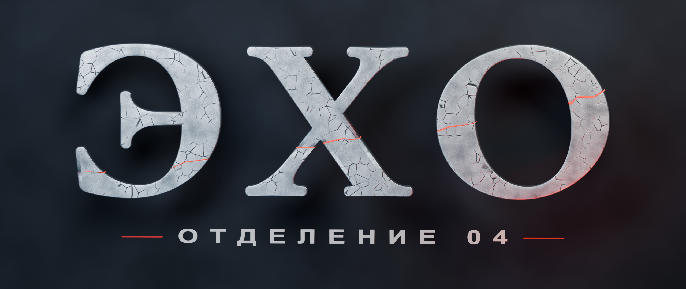
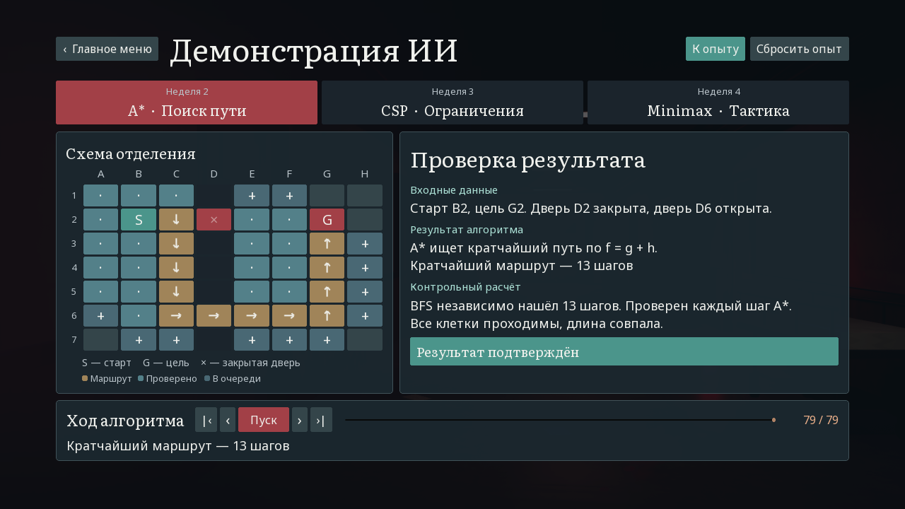

<p align="center">
  
</p>

<h1 align="center">EXO · Отделение 04</h1>

<p align="center">
  
</p>

<p align="center"><strong>QAISAR STUDIO · «Қайсар»</strong><br>Survival horror · Unreal Engine 5.8 · Бета 0.2.0-b117</p>

<p align="center">
  <a href="#об-игре">Об игре</a> ·
  <a href="#исходники">Исходники</a> ·
  <a href="#запуск-проекта-unreal-на-windows">Запуск</a> ·
  <a href="#демонстрация-ии">Демонстрация ИИ</a>
</p>

## Об игре

После ночного звонка Бека приезжает к больнице. На КПП он узнаёт о давней аварии в лаборатории. Чтобы выяснить, что произошло в Отделении 04, ему предстоит исследовать закрытые корпуса, сопоставлять улики и уходить от существ, которые идут на шум.

В проекте есть сюжетная кампания, кооператив и интерактивная демонстрация алгоритмов. Над игрой работает команда из четырёх человек. Демонстрация подготовлена для курса **QAIRU AI Fundamentals**.

## Исходники

| Путь | Содержимое |
|---|---|
| [`unreal/EchoWard`](unreal/EchoWard) | Проект Unreal Engine 5.8, C++ кампании, кооператива и интерфейса, карта, настройки и данные игрового мира |
| `unreal/EchoWard/Content/Python` | Скрипты редактора Unreal для подготовки игрового контента |
| `legacy/godot` | Исходники прежней версии на Godot с её сценами, логикой, тестами и данными |
| [`qa/ai-demo-b117.json`](qa/ai-demo-b117.json) | Результат автоматической проверки демонстрации в собранной игре |

Для полной сборки игры нужны исходные материалы проекта Unreal. Они включают модели, текстуры, озвучку, музыку и анимации. Возьмите соответствующий комплект `Content` у команды и добавьте отсутствующие материалы в `unreal/EchoWard/Content`. При копировании сохраните файлы репозитория с настройками, кодом и данными. Большие медиа и готовая Windows-сборка хранятся отдельно.

## Запуск проекта Unreal на Windows

1. Установите Unreal Engine 5.8 и Visual Studio 2022 с компонентами C++ для Unreal Engine.
2. Выполните `powershell -NoProfile -ExecutionPolicy Bypass -File .\tools\restore-world.ps1`. Скрипт распакует данные больницы и сверит SHA-256.
3. Добавьте комплект исходных материалов игры. Откройте `unreal/EchoWard/EchoWard.uproject`, соберите игровой модуль и нажмите **Play** на карте `Campaign`.

Для сборки модуля редактора из PowerShell укажите путь к установленному Unreal Engine.

```powershell
$ue = 'C:\Program Files\Epic Games\UE_5.8'
$project = (Resolve-Path -LiteralPath '.\unreal\EchoWard\EchoWard.uproject').Path
& "$ue\Engine\Build\BatchFiles\Build.bat" EchoWardEditor Win64 Development "-Project=$project" -WaitMutex
```

Скрипты в `tools/archive` и старые вспомогательные сценарии в `unreal/EchoWard/Tools` относятся к производству карты и ресурсов. Для их повторного запуска проверьте пути к установленным программам и исходным материалам.

## Демонстрация ИИ

В готовой игре откройте **Главное меню → Демонстрация ИИ**. В каждой вкладке можно изменить входные данные, повторить шаги алгоритма и нажать **Проверить результат**.

| Метод | Вход | Проверка |
|---|---|---|
| A* · неделя 2 | Старт, цель и состояние дверей | Поиск в ширину сверяет длину и доступность маршрута. При закрытии D2 обход занимает 13 шагов. |
| CSP · неделя 3 | Возможные позиции припасов и минимальная дистанция | Полный перебор проверяет 8 расстановок. При 4 м подходящих вариантов 0. |
| Minimax · неделя 4 | Позиции охотника и игрока, глубина поиска | Полный перебор и alpha-beta выбирают C4 с оценкой −58. Пройдено 697 и 158 узлов соответственно. |

<details>
<summary>Посмотреть проверку маршрута A* в игре</summary>



</details>

Реализация алгоритмов и интерфейс проверки доступны в исходниках. [WardCampaignAI.cpp](unreal/EchoWard/Source/EchoWard/WardCampaignAI.cpp) · [WardAIDemo115.inl](unreal/EchoWard/Source/EchoWard/WardAIDemo115.inl)

Для автоматической проверки откройте актуальную собранную игру с аргументами `-WardCampaignSmoke -WardAboutMenuCheck -WardAIDemoCheck115 -EchoRelay=disabled`. Запуск создаёт `Saved/Prototype/ai_demo_check.json`. В b117 прошли все 29 проверок.
